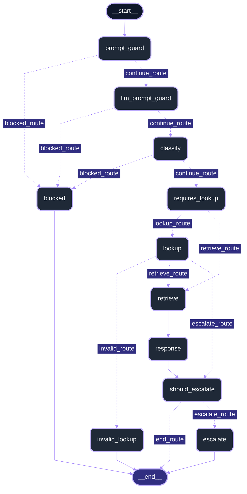

# AI Support Ticket Agent (WIP)
**This project involves an AI agent that classifies support tickets, retrieves relevant context using RAG and either drafts fact-checked responses or escalates to a human if necessary.**

## Progress
- Phase 0 - Set up local LLM + Groq ✅
- Phase 1 - Database setup ✅
- Phase 2 - Retrieval + RAG pipeline ✅
- Phase 3 - Ticket workflow + agent logic ✅
- Phase 4 - UI/UX + testing
- Phase 5 - Deployment + polish

## Setup
**Python 3.14.7** was used for this project.

**Note:** You run setup.bat once to create the virtual environment, download the necessary requirements, and create & populate the database.
1. Run `setup.bat`.
2. This creates a local `.env` if needed.
3. Edit `.env` and set your API key. If you do not already have one, get one here: https://console.groq.com/

### Use the Groq model

Model: `qwen/qwen3.8-27b`

```env
GROQ_API_KEY=your_key_here
LLM_BACKEND=groq
```

> Warning: this setup was validated with the tested model above. Other models may require different configuration, tuning, or prompt adjustments and are not guaranteed to work correctly.

## Run the dashboard

From the project root, using the Python environment created during setup, run:

```powershell
python -m streamlit run app/dashboard.py
```

The `app` folder contains the dashboard, support ticket page, company policies page and a read-only demo data page for browsing accounts and orders. Ticket history displays saved records from `logs/final_ticket.json`, including responses, verification and escalation results.

## Run the ticket workflow

From the project root, using the Python environment created during setup, run:

```powershell
python -m src.graph
```

Run this as a module so Python can resolve the `src.*` imports. Running `python src/graph.py` directly can cause `ModuleNotFoundError: No module named 'src'`.

## Optional: run locally with llama.cpp

Model: `Qwen_Qwen3.5-4B-Q4_K_M`

1. Install llama.cpp into the root directory from the official repo: https://github.com/ggml-org/llama.cpp/releases
2. Put your GGUF model in `model\`.
3. Update `.env`:

```env
LLM_BACKEND=local
```

5. Start the server:

```bat
run.bat
```

> Warning: this setup was validated with the tested model above. Other models may require different configuration, tuning, or prompt adjustments and are not guaranteed to work correctly.

## Evaluation

This section records the baseline performance of the classifier evaluation runs using the two model backends.

### Baseline results

- Groq API model: `qwen/qwen3.8-27b`
  - Result: `PASSED: 218 FAILED: 51`
  - Accuracy: `81.04%`

- Local model: `Qwen_Qwen3.5-4B-Q4_K_M`
  - Result: `PASSED: 205 FAILED: 64`
  - Accuracy: `76.21%`

### Summary

The Groq API model performed better during the evaluation of ticket classification, achieving an overall accuracy of 81.04%, compared with 76.21% for the local model. These values serve as the initial benchmark for future improvements.

### Raw evaluation logs

- Groq API model log: [logs/myfile163734.txt](logs/myfile163734.txt)
- Local model log: [logs/myfile174823.txt](logs/myfile174823.txt)


