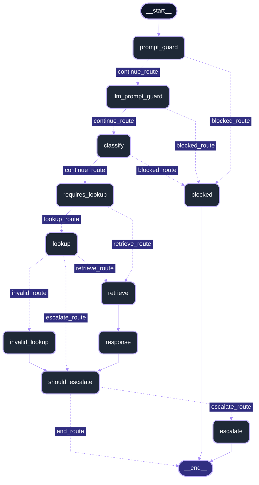

# AI Support Ticket Agent
This project is an AI Ticketing System that can classify a ticket based on preset categories, determine the urgency of the ticket and autonmously make use of tools to get information from a database. It uses Retrieval-Augmented Generation (RAG)  to draft and self verify a reply for a customer ensuring that the replies are grounded in company policies. It also includes evaluation scripts for various aspects of the ticket workflow and demonstrates incremental improvements in accuracy, particularly in ticket classification.

This project was built using **Python 3.14.7** and makes use of Groq to host the AI the model and Langraph for ochestrating the ticket workflow. Streamlit was used to host and deploy the application.

[](https://i-support-ticket-agent.streamlit.app/) 
>The app may take a few minutes to start if it’s asleep.

## Progress
- Phase 0 - Set up local LLM + Groq ✅
- Phase 1 - Database setup ✅
- Phase 2 - RAG pipeline ✅
- Phase 3 - Ticket workflow + agent logic ✅
- Phase 4 - UI/UX + testing ✅
- Phase 5 - Deployment + polish ✅

## Setup
**Note:** You run setup.bat once to create the virtual environment, download the necessary requirements, and create & populate the database.
1. Run `setup.bat`.
2. This creates a local `.env` if needed.
3. Edit `.env` and set your API key. If you do not already have one, get one here: https://console.groq.com/

```env
GROQ_API_KEY=your_key_here
LLM_BACKEND=groq
```

> Warning: this setup was validated with the tested model above. Other models may require different configuration, tuning, or prompt adjustments and are not guaranteed to work correctly.

### Launching

From the project root, using the Python environment created during setup, run:

```
python -m streamlit run app/dashboard.py
```

## Optional: run locally with llama.cpp (UNSUPPORTED)

> Warning: Groq was primarily used to for creating and testing the application. While the backend supports llama.cpp and local integration, it is not guranteed that the app will function without further tweaks.


1. Install llama.cpp into the root directory from the official repo: https://github.com/ggml-org/llama.cpp/releases
2. Put your GGUF model in `model\`.
3. Update `.env`:

```env
LLM_BACKEND=local
```

5. Start the server:

```bat
run.bat
```


## How it works

1. **Check the request.** The agent checks for attempts to override its instructions and rejects requests outside its support scope.
2. **Understand the ticket.** It categorizes the ticket and determines its urgency.
3. **Find relevant information.** It retrieves relevant company policy extracts and can look up information from a database if deemed necessary.
4. **Draft and check a response.** It uses the retrieved information to draft an answer, then self evaluates whether the sources support it.
5. **Record the outcome.** It saves the response and processing results, including whether the ticket requires human review.

## Evaluation

A summary of some of the evaluations carried out. For full evaluation details, refer to the source logs.

### Classification accuracy

Tests how reliably the classifier categorizes support tickets. Each of the three saved runs contains 269 tickets. Accuracy is the number of correct category predictions divided by the number of evaluated tickets.

| Version | Change | Passed | Failed | Accuracy |
| --- | --- | ---: | ---: | ---: |
| v1 | Qwen 27B baseline; strict JSON schema output disabled | 201 | 68 | 74.72% |
| v2 | GPT-OSS 120B; strict JSON schema output enabled | 223 | 46 | 82.90% |
| v3 | GPT-OSS 120B with classifier prompt adjustments | 241 | 28 | 89.59% |

The model and output configuration change in v2 increased accuracy by 8.18 percent. Prompt adjustments in v3 further increased accuracy by  6.69 percenta.

### Retrieval evaluation

Tests how reliably the policy search retrieves relevant source material for a support question. The evaluation uses 20 test questions, with scores averaged across the questions. Here, `k` is the number of policy chunks retrieved.

| Top k chunks | Hit@k | Recall@k | Precision@k |
| ---: | ---: | ---: | ---: |
| 1 | 85% | 80% | 85% |
| 3 | 100% | 95% | 77% |
| 5 | 100% | 100% | 60% |
| 10 | 100% | 100% | 42% |

- **Hit@k — Did we find anything useful?** How often the first k results include at least one expected policy file.
- **Recall@k — How much of what we needed did we find?** The share of expected policy files found in the first k results.
- **Precision@k — How much of what we found was useful?** The share of the first k chunks that come from expected policy files.

### Source logs

- [v1: Qwen 27B baseline](logs/EVALUATE_CLASSIFIER_QWEN_27B_STRICT_FALSE_v1.txt)
- [v2: GPT-OSS 120B with strict output](logs/EVALUATE_CLASSIFIER_GPT_120B_STRICT_TRUE_v2.txt)
- [v3: GPT-OSS 120B with prompt adjustments](logs/EVALUATE_CLASSIFIER_GPT_120B_STRICT_TRUE_v3.txt)
- [Retrieval evaluation](logs/EVALUATE_RETRIEVAL_GPT_120B.txt)

## Limitations

- Strict rate limits on the free groq plan mean that the demo is not suitable for multi-user use or high traffic usage.
- Each submission is processed independently, so follow-up questions must include the relevant details again.
- Escalation is recorded for demonstration purposes. It does not contact a real support team.
- AI-generated answers and its self verification check can both make mistakes.
- Support for local backend is limited

## AI usage

AI tools assisted with: 

- Creating fictional company policies and demo data. 
- Building the frontend. 
- Drafting evaluation test cases. 
- Generating system prompts. 
- Reviewing human-written code. 

I designed and implemented most of the backend, including the RAG system, agent tool-calling capabilities, Langgraph workflow and the evaluation tests.

## Acknowledgments

This project uses [Bitext's Customer Support Training Dataset](https://huggingface.co/datasets/bitext/Bitext-customer-support-llm-chatbot-training-dataset) for ticket categorization and in evaluation.

## Workflow diagram


